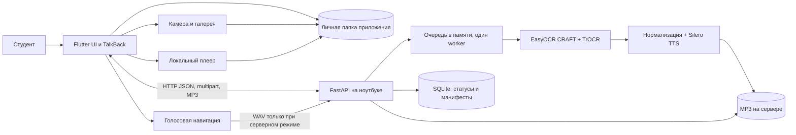
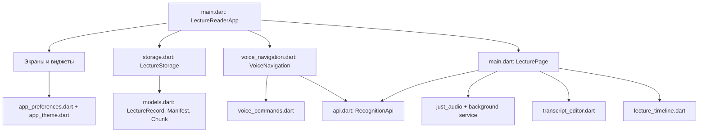
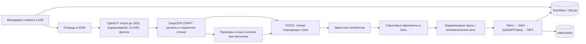
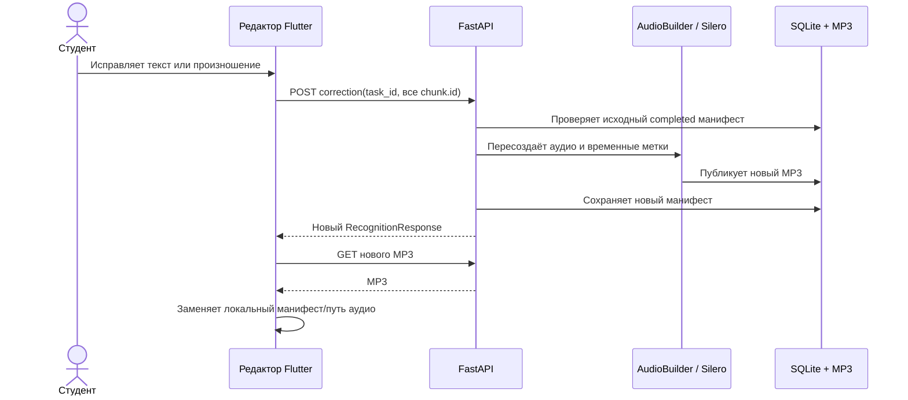

# Архитектура системы «Лектория.Ai»

**Состояние кода:** 28 октября 2026 года. **Назначение:** опорное описание фактически реализованных компонентов для разработки, тестирования и подготовки ВКР. Документ описывает текущий рабочий каталог, включая ещё не опубликованные изменения. Проверка на реальном Galaxy A22 после последних изменений не проводилась; наличие функции в коде не означает подтверждения её работы на устройстве.

## 1. Границы системы

«Лектория.Ai» состоит из мобильного клиента Flutter и одного процесса сервера FastAPI на ноутбуке. **Единица серверной обработки — одна фотография страницы.** Клиент объединяет такие страницы в лекцию, сохраняет результат и управляет воспроизведением. Сервер выполняет ресурсоёмкое распознавание и синтез речи. Интернет для основных моделей не требуется, если их веса заранее установлены локально и выбран офлайн TTS. Телефон и ноутбук должны иметь сетевую связность для отправки снимка, голосового резервного ввода и повторной озвучки исправлений.



| Вопрос | Текущее решение |
|---|---|
| Мобильная платформа | Flutter/Dart; Android собирается на текущем ноутбуке. В проекте есть каталог iOS, но сборка и проверка iOS здесь не проводились. |
| Сервер | Python 3.12, FastAPI/Uvicorn, один процесс и один последовательный worker для OCR/TTS. Настройки из `.env` через Pydantic Settings. |
| Связь | HTTP API `/api/v1`, JSON, `multipart/form-data`, относительные ссылки `/audio/*.mp3`. Адрес сервера задаётся на телефоне. |
| Учётные записи | Не реализованы. `task_id` не является механизмом авторизации; API и статические MP3 доступны тому, кто может обратиться к серверу. |
| Локальность данных | Снимки, манифесты и загруженные MP3 хранятся на телефоне; сервер хранит манифесты и созданные MP3. Исходные байты снимка находятся в памяти очереди и не записываются сервером как постоянный файл. |
| Многостраничная лекция | Отдельные серверные задания, объединённые на клиенте по `seriesId`; сервер не знает о составе лекции. |

## 2. Клиент: слои и ответственность

Клиент сейчас организован вокруг `LectureReaderApp` и `LecturePage` в [main.dart](client/app/lib/main.dart). Это координирующие виджеты: они владеют списком локальных лекций, маршрутами, настройками, состоянием страницы и плеером. Остальные файлы выделяют интерфейс и отдельные функции; отдельного слоя репозиториев или централизованного менеджера состояния пока нет.



| Подсистема / файлы | Роль | Где выполняется |
|---|---|---|
| `main.dart`, `home_page.dart`, `lecture_view.dart`, `lyrics_player.dart` | Запуск, библиотека, маршруты, экран лекции, отображение фрагментов и управление плеером. | Телефон |
| `capture_page.dart`, `camera_guidance_page.dart`, `capture_review_page.dart`, `text_frame_assessment.dart` | Выбор источника, живой анализ уменьшенных кадров для подсказок, консервативная автосъёмка, просмотр качества перед отправкой. Анализ кадра здесь **не является OCR**. | Телефон |
| `api.dart` | Проверка адреса, HTTP запросы, проверка ответов, загрузка MP3 во временный файл с переименованием. | Телефон ↔ сервер |
| `models.dart` | Декодирование манифеста и локальной записи, фрагменты, закладки по стабильным `chunk.id`, принадлежность страницы лекции. | Телефон |
| `storage.dart`, `library_backup.dart` | Локальная библиотека, настройки, исходные фото, аудио и ZIP копия библиотеки. Индекс и настройки пишутся через `.tmp` с резервной `.bak`. | Телефон |
| `voice_navigation.dart`, `voice_commands.dart` | Единый владелец микрофона, распознавание Android либо серверный Vosk, разбор фразы и передача действия активному экрану. | Телефон; опционально сервер |
| `transcript_editor.dart`, `formula_breakdown.dart`, `photo_line_preview.dart` | Исправление текста/типа фрагмента/произношения, просмотр шагов формулы, показ области на фотографии. | Телефон; повторная озвучка на сервере |
| `lecture_timeline.dart`, `lecture_export.dart`, `mp3_joiner.dart` | Навигация по нескольким страницам, TXT и MP3+LRC экспорт. MP3 объединяется на телефоне без перекодирования при совместимых форматах страниц. | Телефон |
| `settings_page.dart`, `app_preferences.dart`, `app_theme.dart`, `help_page.dart`, `app_haptics.dart` | Настройки доступности и связи, справка, темы, вибрация и звуковые сигналы. | Телефон; озвучка справки может запрашиваться с сервера |

### Экранные маршруты

| Экран | Основное действие | Источник данных |
|---|---|---|
| Загрузка/приветствие → главная/библиотека | Настроить приложение, открыть или найти лекцию, создать страницу, открыть заметки. | Локальные `settings.json` и `lectures.json`. |
| Съёмка → проверка снимка | Наведение, ручной/автоматический спуск, выбор из галереи, подтверждение фото. | Камера и выбранный локальный файл. |
| Студия лекции | Ожидание обработки, прослушивание, переход к фрагменту/странице, фото, закладки, экспорт. | Локальный манифест/MP3; сервер при первом запросе или восстановлении. |
| Редактор расшифровки | Поиск и исправление фрагмента, удаление, смена «текст/формула», точная фраза для озвучивания, голосовая диктовка. | Манифест страницы; POST исправления на сервер. |
| Закладки, заметки, справка, настройки, разбор формулы | Быстрая навигация, помощь и персонализация. | В основном локальные данные; сервер может озвучить справку. |

### Доступность и управление

Интерфейс содержит семантические подписи для экранного диктора, крупные зоны нажатия у основных действий, разные палитры (включая контрастные варианты), масштаб текста, альтернативные гарнитуры, настройки движения и маскота, визуальную «линейку чтения», тактильные и тональные сигналы. Воспроизведение использует `just_audio` и `just_audio_background` для уведомления и медиакнопок Android. Голосовая навигация включается кнопкой микрофона; сначала пробуется системная служба Android, в режиме `auto` при её недоступности используется серверный Vosk. Распознанная фраза разбирается на телефоне и передаётся активному экрану, затем глобальному обработчику. При неизвестной или недоступной команде есть текстовый и речевой отклик. Для серверной диктовки редактора используется отдельный свободный режим Vosk. **Постоянного прослушивания при заблокированном экране нет.** Работа TalkBack, вибрации, автосъёмки и служебных разрешений на конкретном телефоне требует проверки на устройстве.

## 3. Сервер: слои и конвейер

Точка запуска — [run.py](run.py): один Uvicorn worker. [server/app/main.py](server/app/main.py) создаёт приложение, загружает модели при старте, инициализирует SQLite, проверяет FFmpeg, создаёт очередь с максимальным числом ожидающих заданий (`MAX_PENDING_TASKS`, по умолчанию 2) и один `process_task_queue`. Тяжёлое задание выполняется в отдельном потоке последовательно. `audio_lock` также сериализует повторную озвучку исправлений и генерацию справки с общим TTS. Резервная голосовая модель Vosk загружается только при первом голосовом запросе.



| Компонент / файл | Фактическая роль |
|---|---|
| `routes/recognition.py` | Приём и проверка снимка; жизненный цикл задания; запуск конвейера; выдача результата; повторная озвучка исправленного текста без повторного OCR. |
| `services/image_preprocessing.py` | Уменьшение большей стороны до 1920 пикселей, коррекция наклона, CLAHE и сглаживание; эвристики строк, колонок и границ чернил. |
| `services/text_recognition.py` | EasyOCR CRAFT и первичное распознавание; TrOCR для кандидатов рукописи; резервные проекции/колонки при слабой детекции. TrOCR работает на CPU по умолчанию, декодер может квантоваться до INT8. |
| `services/content_classifier.py`, `semantic_chunker.py` | Эвристическая классификация формулы; объединение строк в предложения или отдельные формулы. Фрагмент может содержать несколько OCR строк; его `bbox` — общий прямоугольник. |
| `services/speech_normalizer.py`, `math_speech.py`, `formula_to_speech.py` | Подготовка текста для произнесения. `full_text` и `spoken_text` хранятся раздельно. |
| `services/tts_engine.py`, `silero_tts.py`, `audio_builder.py` | По умолчанию локальный Silero (`xenia`), синтез каждого фрагмента, пауза 350 мс, единый MP3 страницы и временные метки в секундах. `pyttsx3`/`gTTS` требуют явной настройки; онлайн TTS по умолчанию отключён. |
| `routes/voice.py` | Опциональный серверный ввод WAV 16 кГц, моно, PCM 16 бит через Vosk: ограниченная грамматика команд или свободная диктовка. Возвращает **текст**, действие исполняет клиент. |
| `routes/help_speech.py` | Короткая озвучка справки общим TTS, кеш MP3 по хешу текста. |
| `task_store.py`, `models.py` | SQLite с JSON манифестом и статусом; Pydantic контракт ответа. SQLite работает в WAL, соединение открывается на каждую операцию. |
| `utils/logger.py` | INFO журнал в консоль и `server/logs/server.log`, суточная ротация. Журнал фиксирует этапы, время, число строк/фрагментов и ошибки. |

**Особенность координат:** `bbox=[left, top, right, bottom]` и `image_width`/`image_height` в ответе относятся к пикселям исходного фото. Для получения бокса сервер пересчитывает координаты с рабочей уменьшенной копии. Исходное фото не сохраняется сервером. В текущем пути `recognize_with_source` оригинал снова декодируется, затем приводится к рабочим размерам перед детекцией/чтением: нельзя описывать это как распознавание каждой полосы напрямую из неизменённого 4K изображения. `confidence` у TrOCR не является откалиброванной вероятностью правильного слова; для него сохраняется оценка детектора.

## 4. Протокол клиента и сервера

Базовый адрес имеет вид `http(s)://<хост>:<порт>/`. Актуальные модели запросов определены в [server/app/models.py](server/app/models.py), клиентский вызов — в [client/app/lib/api.dart](client/app/lib/api.dart). Полная схема также лежит в [client/api/openapi.v1.json](client/api/openapi.v1.json); при расхождении приоритет имеет работающий код маршрутов.

| Метод и путь | Вход | Выход и назначение |
|---|---|---|
| `GET /health` | — | `status`, `version`, `models_loaded`; 503, пока модели не готовы. |
| `GET /info` | — | Версия, устройство, модели, язык, TTS, состояние очереди. |
| `POST /api/v1/recognition/upload` | `multipart` поле `file` + `X-Upload-Id: UUID` | HTTP 202, `{task_id,status}`. JPEG/PNG/WEBP, до 15 МиБ, 20 Мп и 6000 пикселей по стороне. Одинаковые UUID+хеш снимка идемпотентны; другой снимок с тем же UUID → 409. |
| `GET /api/v1/recognition/status/{task_id}` | UUID | `pending`, `processing`, `completed` или `failed`, возможная ошибка. |
| `GET /api/v1/recognition/result/{task_id}` | UUID | Манифест `RecognitionResponse`; до готовности HTTP 202. При `failed` результат может содержать уже распознанный текст. |
| `POST /api/v1/recognition/result/{task_id}/correction` | JSON список всех исходных `chunk.id`, исправленный `text`, `is_formula`, необязательный `spoken_text`/`remove` | Новый манифест и MP3 без повторного OCR. Количество и порядок ID должны совпадать с текущим результатом; удалить можно отдельный фрагмент, но не все. |
| `GET /audio/{name}.mp3` | Имя из `audio_url` | MP3 лекции или справки; статический файл. |
| `GET /api/v1/voice/availability` | — | Доступность установленной серверной модели Vosk. |
| `POST /api/v1/voice/command[?mode=dictation]` | Короткий WAV 16 кГц, моно, 16 бит | `{text}`; обычный режим ограничивает словарь, `dictation` принимает произвольную фразу. |
| `POST /api/v1/help/speech` | JSON `{text}` до 3500 символов | `{audio_url}` к кешированной озвучке справки. |

**Ошибки:** 400/413/415/422 — некорректный ввод, 404 — неизвестное задание, 409 — конфликт ID или неготовый результат, 429 + `Retry-After` — очередь заполнена, 503 — модели/озвучка недоступны. Клиент переводит большинство таких ответов в понятные сообщения (`user_error.dart`). Задания `pending` и `processing` после перезапуска сервера переводятся в `failed`, поскольку изображения в SQLite нет; клиенту нужно повторно отправить сохранённое фото.

### Состав манифеста

| Поле | Смысл и единица |
|---|---|
| `task_id`, `status`, `created_at`, `processing_time`, `error` | ID, состояние, время создания, время обработки в секундах, причина ошибки. |
| `full_text`, `spoken_text` | Распознанная запись и текст, подготовленный для TTS. |
| `audio_url`, `total_duration` | Относительный путь MP3 страницы; продолжительность в секундах. |
| `image_width`, `image_height` | Размер исходной фотографии для наложения областей. |
| `chunks[]` | Упорядоченные смысловые фрагменты: `id`, `index`, `content_type`, `is_formula`, `text`, `spoken_text`, `confidence`, `bbox`, `start_time`, `end_time`, `duration`. Времена — секунды от начала MP3 **этой страницы**. |

### Сценарий нового снимка и восстановления связи

```mermaid
sequenceDiagram
    actor Student as Студент
    participant Phone as Flutter + локальная папка
    participant Api as FastAPI
    participant Worker as OCR/TTS worker
    participant DB as SQLite/MP3
    Student->>Phone: Снимает и подтверждает страницу
    Phone->>Phone: Сохраняет фото и UUID
    Phone->>Api: GET status(UUID)
    alt Задание неизвестно
        Api-->>Phone: 404
        Phone->>Api: POST upload(file, X-Upload-Id: UUID)
        Api->>DB: Создаёт pending + SHA-256
        Api->>Worker: Кладёт байты в очередь RAM
        Api-->>Phone: 202 pending
    else Задание уже принято
        Api-->>Phone: Текущий статус
    end
    loop Каждые ~2 с до completed/failed
        Phone->>Api: GET status(UUID)
        Api-->>Phone: pending / processing / completed / failed
    end
    Worker->>DB: Сохраняет манифест и MP3
    Phone->>Api: GET result(UUID)
    Api-->>Phone: Манифест
    Phone->>Api: GET /audio/*.mp3
    Api-->>Phone: MP3
    Phone->>Phone: Сохраняет MP3 и индекс; воспроизводит локально
```

При сетевой ошибке фото остаётся на телефоне. `LecturePage` делает автоматические повторы для недоступного сервера с растущей задержкой, а при повторном открытии сначала проверяет `status(UUID)`, чтобы избежать дублирующей обработки. Для HTTP 429 выполняется ограниченное число повторов с учётом `Retry-After`.

### Сценарий исправления



Если синтез не удался, сервер оставляет прежний результат. Если сервер уже сохранил исправленный манифест, но клиенту не удалось скачать новый MP3, клиент восстанавливает прежний **локальный** манифест и аудио; состояние сервера и телефона в этот момент может различаться до повторной синхронизации. Исходное OCR при исправлении не запускается. Сервер сохраняет новый MP3 с новым именем; очистка старых серверных аудиофайлов сейчас не автоматизирована.

## 5. Данные и жизненный цикл

| Место | Что хранится | Важные связи |
|---|---|---|
| Личная директория приложения `lectures/` | `lectures.json`, `settings.json`, фотографии `<task_id>.<ext>`, MP3, резервные `.bak`. | Каждый `LectureRecord` содержит `taskId`, адрес сервера, локальные пути, встроенный манифест, название, последнюю позицию, ID закладок и проверенных фрагментов, `seriesId`, `pageOrder`. |
| ZIP копия библиотеки | Индекс и принадлежащие приложению фото/MP3. | Настройки доступности и адрес сервера в архив не входят. Восстановление объединяет записи по новым `taskId`, не перезаписывая существующие. |
| `server/data/tasks.sqlite3` | Таблица `tasks`: ID, статус, время, JSON манифеста, ошибка, SHA-256 снимка. | Не содержит исходное изображение; после перезапуска незавершённые задания становятся `failed`. |
| `static/audio/` | MP3 страниц и справки. | URL из манифеста указывает на файл в этой директории. |
| `server/temp/` | Временные WAV/MP3 на время синтеза. | Файлы удаляются по завершении соответствующей операции. |
| `server/models/` | Локальные веса OCR, Silero и необязательного Vosk. | Крупные модели предзагружаются при старте сервера; Vosk лениво. |
| `server/logs/server.log` | Операционный журнал с суточной ротацией. | Для диагностики используются `task_id`, этап и длительность. |

У каждой страницы собственный `taskId` и MP3. Для лекции из нескольких страниц клиент задаёт общий `seriesId` и сортирует страницы по `pageOrder`. Плеер переводит время всей лекции в локальное время страницы через `LectureTimeline`; между страницами открывается следующий локальный MP3. При экспорте текст страниц складывается в TXT, аудиокадры MP3 объединяются в один файл и создаётся сопутствующий LRC с временными метками. Это **клиентская** операция, для которой все страницы должны иметь готовые локальные записи и совместимые параметры MP3.

## 6. Развёртывание, ограничения и проверка

| Аспект | Текущее положение / следствие |
|---|---|
| Ноутбук без дискретной GPU | `USE_GPU=false`; EasyOCR и TrOCR работают на CPU, задачи OCR/TTS последовательно. Это снижает пик параллельной нагрузки, но не гарантирует фиксированное потребление RAM и время на страницу. |
| Зависимости | Нужны Python пакеты из `requirements.txt`, заранее скачанные веса моделей и FFmpeg. Если они отсутствуют, `/health` возвращает 503. |
| Сеть и транспорт | Сервер по умолчанию слушает `0.0.0.0:8000`. Аутентификации и TLS в приложении сервера нет. У Android явное разрешение cleartext HTTP найдено только в **debug** манифесте; для release подключение по локальному `http://` следует проверять отдельно и для распространяемой версии проектировать HTTPS. |
| Точность OCR | Классификатор формул и резервная сегментация являются эвристиками. Плотный курсив, тетрадная сетка и просвечивание с оборота по-прежнему могут давать ошибки. Редактор позволяет исправить результат, но это не означает «идеальную» точность модели. |
| Распределённость | Один процесс, очередь только в RAM, SQLite локально, нет восстановления обработки после рестарта и нет синхронизации библиотек разных устройств. |
| Исправления при обрыве сети | Публикация результата на сервере и скачивание MP3 на телефон не являются одной транзакцией; после обрыва связи возможна временная разница версий. |
| Доступность | Статический и автоматизированный контроль не заменяет проверки с TalkBack, камерой, микрофоном, вибрацией, медиакнопками, разными темами и масштабом на Galaxy A22. iOS/VoiceOver не проверены. |

**Минимальная проверка интеграции:** запустить `python run.py`; дождаться `GET /health` со статусом `ok`; в клиенте проверить адрес сервера; загрузить снимок; дождаться `completed`; открыть локальный MP3 и переход по фрагментам; исправить один фрагмент и скачать новую запись; отключить сеть и проверить локальное воспроизведение; повторить загрузку при потере связи. Для доступности пройти основные экраны с TalkBack и крупным системным шрифтом. Этот список служит критерием проверки архитектурных связей, а не утверждением, что все сценарии уже прошли на устройстве.

## 7. Карта первоисточников и правило обновления

| Что меняется | Где искать первоисточник |
|---|---|
| HTTP контракт, коды ответов, жизненный цикл задачи | `server/app/routes/*.py`, `server/app/models.py`, `client/app/lib/api.dart` |
| OCR, сегментация, формулы, TTS | `server/app/services/*.py`, `server/config.py` |
| Библиотека, страницы, закладки, офлайн файлы | `client/app/lib/models.dart`, `storage.dart`, `main.dart`, `lecture_timeline.dart` |
| Голосовое управление и доступность | `client/app/lib/voice_navigation.dart`, `voice_commands.dart`, `app_preferences.dart`, `app_theme.dart` |
| Мобильные разрешения и фоновые службы | `client/app/android/app/src/main/AndroidManifest.xml`, `client/app/android/app/src/debug/AndroidManifest.xml` |
| Проверки поведения | `client/app/test/`, `tests/` |

При изменении API, формата манифеста, мест хранения, последовательности обработки или владельца функции обновлять этот документ в той же задаче. Старые README и отчёты могут описывать ранние версии; их утверждения нужно сверять с указанными выше файлами.
